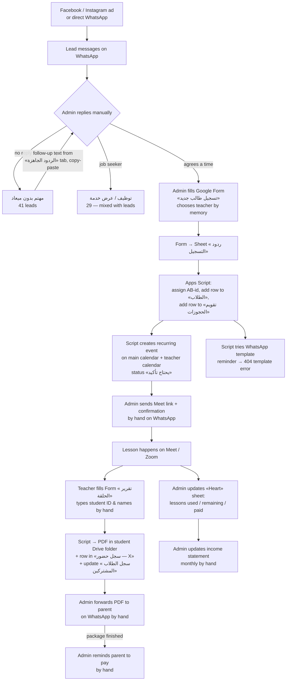

# 01 — Current System (As-Is) — أكاديمية آيات البيان

Analysis date: 2026-10-01. Sources: Google Forms (2), Google Sheets (≈75 files), Google Calendar (13 calendars), Apps Script "Ayat AlBayan - Sheet & Calendar Sync".

## 1. What the business does

Online Quran / Arabic / Islamic-studies lessons (حلقات) on Zoom / Google Meet, 45 min default, taught by freelance teachers paid per lesson (EGP). Students are mostly in Saudi Arabia (+966), also Egypt, Sudan, Oman, Qatar, Yemen, Finland. Sales happen 100% on WhatsApp. First lesson is a free trial; then packages of 4 / 8 / 12 / 16 lessons per month.

Scale today (from the sheets): 107 WhatsApp conversations logged, 182 student IDs issued (AB-0001…AB-0182, incl. test rows), 60 students with at least one lesson report, ~9 paying subscribers, 11 teachers, ~22 "current students" on the dashboard.

## 2. The tools in use

| # | Tool | Purpose | Owner |
|---|------|---------|-------|
| T1 | WhatsApp (personal/business number) | All lead conversations, confirmations, sending links & PDFs | Admin |
| T2 | Google Form «استمارة تسجيل طالب جديد» | Admin fills it *after* agreeing on WhatsApp. Fields: name, WhatsApp, age, gender, available days, hour, first-lesson date, teacher (dropdown of 11), duration (30/45/60/90), package (trial/4/8/12/16), source | Admin |
| T3 | Sheet «نسخة تجريبية (نظام تسجيل الطلاب)» | Hub: ردود التسجيل (form responses), الطلاب (AB-ids), المعلمين (M-01…), تقويم الحجوزات, كل المحادثات, الردود الجاهزة, لينكات الحلقات, المواعيد المتاحة, سجل التذكيرات, ردود التوظيف, لوحة الملخص | Admin |
| T4 | Sheet «الحجوزات والمحادثات» | Older copy of the same hub (bookings 284 rows, conversations 108 rows, teachers tab with calendar IDs, dashboard) | Admin |
| T5 | Apps Script «Sheet & Calendar Sync» | Assigns AB-ids, builds recurring Google Calendar events on the main calendar + per-teacher calendars, writes event IDs back, tries to send WhatsApp reminders via Meta Cloud API | Script |
| T6 | Google Calendar — main + 11 teacher calendars | Visible schedule per teacher («آيات البيان — Abrar» …) | Script |
| T7 | Google Form «تقرير الحلقة» | Teacher fills after every lesson: IDs (typed by hand), date, lesson no., program, attendance, recited / new memorization / revision / theory, 6 rubric grades, overall grade, notes, homework, next plan, attachments | Teacher |
| T8 | Sheet «سجل تقارير الحلقات» + script | Generates branded PDF into the student's Drive folder, appends a row to the per-student «سجل حضور — X» sheet, updates «سجل الطلاب المشتركين» (60 rows) | Script |
| T9 | ~60 per-student sheets «سجل حضور — X» + 60 Drive folders | One attendance log + folder per student | Script |
| T10 | Sheet «Ayat ALBayan Heart» | Manual weekly timetable per teacher (ABRAR / RABIA / HEND tabs) + «subscription» tab: paid status, lessons used, remaining | Admin |
| T11 | Sheet «Main income statment» | Monthly P&L in EGP (Aug: −19,723; Sept: −1,988.5), staff cost per student per teacher | Admin |
| T12 | Form «رأيك يهمّنا» | Feedback form (unused, 1 KB) | — |

## 3. End-to-end flow today

### 3.1 Lead stage (WhatsApp → sheet)
1. A message arrives. Admin answers, explains the free trial, asks for a time.
2. Admin logs the conversation manually in «كل المحادثات» (date, number, name, status, agreed time, source, free-text summary).
3. Non-responders get a templated follow-up from «الردود الجاهزة» (two proposed slots, copy-pasted via `ابعت ↗` wa.me link; the `اتبعت؟` column is never filled).
4. Statuses in use: حجز مؤكد 16 · حجز مبدئي 5 · مهتم بدون ميعاد 41 · مردّش 3 · عميل ضايع/اعتذر 2 · توظيف 29 · جروب حلقة 11.

### 3.2 Registration + teacher assignment
1. Admin fills the registration form on behalf of the lead. Teacher is a dropdown of 11 names (free "Other" allowed). Availability/capacity of the teacher is not checked anywhere — admin relies on memory and the «Heart» timetable.
2. Script assigns `AB-nnnn`, writes to «الطلاب», creates a booking row, and recurring calendar events (e.g. "16 lessons → weekly Sat/Tue/Thu until 2026-10-06").
3. Events are titled «حلقة — {name} (يحتاج تأكيد)» and the description says "edit in the sheet, not here".

### 3.3 Lesson delivery
1. Teacher has a fixed Google Meet link (in «المعلمين» tab). Admin sends link + confirmation message manually.
2. Reminders were meant to be automatic (Meta Cloud API). Every attempt in «سجل التذكيرات» (636 rows) failed with `132001 Template name does not exist`.

### 3.4 Lesson report
1. Teacher opens the report form, types student ID / teacher name / student name manually (fields labelled "لا تعدله" but not pre-filled), fills content, 6 rubric grades, overall grade, notes, homework, next plan.
2. Script renders a PDF → student folder → appends to «سجل حضور — X» → updates summary sheet. Admin sends PDF to parent manually.

### 3.5 Subscription & money
1. Package and payment tracked by hand in «Heart › subscription» (Paid / Not paid, lessons used, remaining).
2. Teacher pay per student entered by hand into the income statement.
