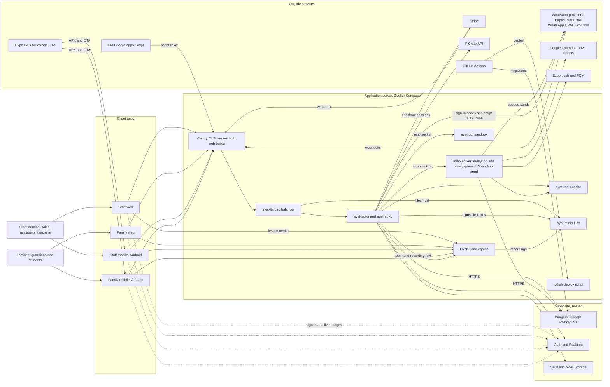
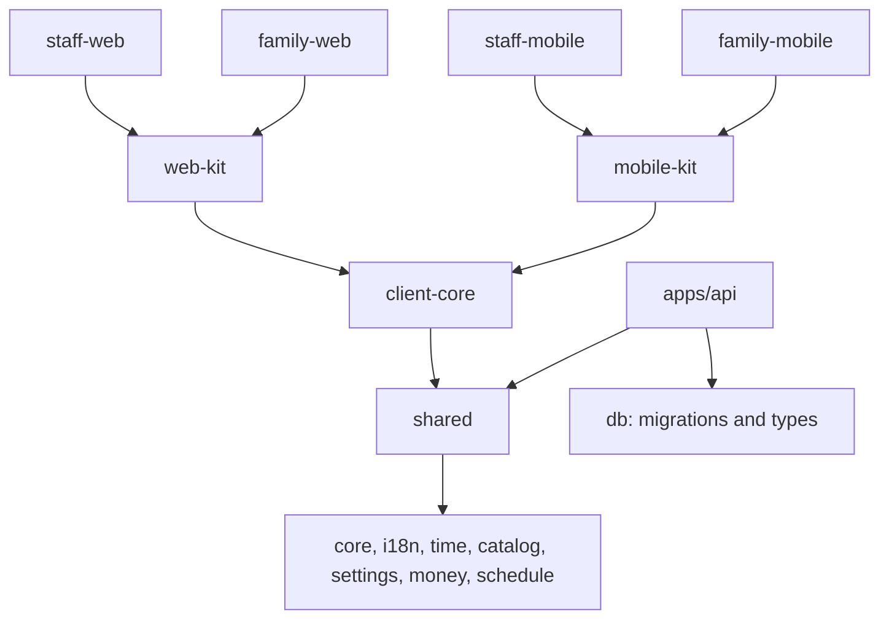
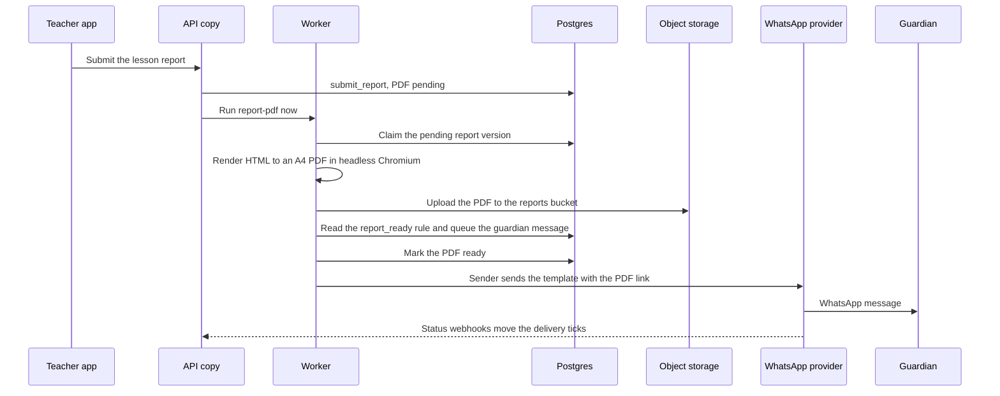
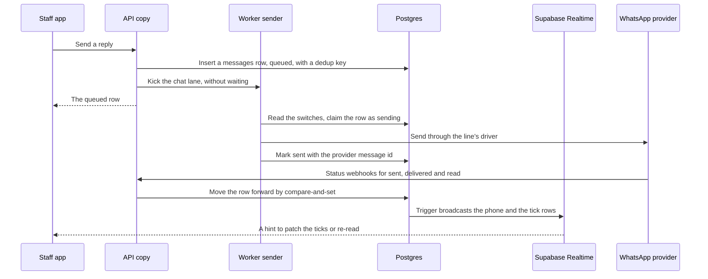

# Ayat Al-Bayan platform architecture

Date: 2026-11-21. Code at develop 145012463.

This is the architecture reference for engineers joining the project. It describes how the system is built, deployed and checked. Capacity figures, security findings, backup arrangements and known limits are kept in a private operations report kept by the owner.

File references point to commit 145012463 and are relative to the repository root. A shortened path continues from the last full path cited before it, and bare migration file names live in packages/db/supabase/migrations. Where docs/04-architecture.md disagrees with this document, this document matches the code.

## 1. System at a glance

Ayat Al-Bayan replaces the academy's Google Forms, Sheets, Calendar and Apps Script. Families reach the academy on WhatsApp. Sales staff turn a lead into a student, book a trial and then a course, and record the package payment. Teachers hold the lesson in Google Meet or in the in-house LiveKit room and file a lesson report, which reaches the guardian as a PDF on WhatsApp. Admins run packages, payments and teacher payouts.

| Component | Where it runs | Job |
|---|---|---|
| Caddy | The server host | TLS for every site; serves the staff and family web builds from disk; proxies the API and files hosts to the load balancer |
| ayat-lb | Container | Round robin over the two API copies with health checks; sends the files host to MinIO (deploy/staging/lb/Caddyfile) |
| ayat-api-a, ayat-api-b | Containers | All HTTP routes and webhooks, no jobs. They also send sign-in codes and Apps Script relay messages inline, without the worker (deploy/staging/docker-compose.yml) |
| ayat-worker | Container | The only job runner: 29 background jobs, including the sender for every queued WhatsApp row, report PDFs, Google sync and the Drive backup |
| ayat-pdf | Container | Turns chat PDFs into page images; its own entry point in the same image, no network, no secrets |
| ayat-redis | Container | Optional shared cache and invalidation bus |
| ayat-minio | Container | Object storage for new files and recordings |
| LiveKit and egress | The server, configured outside the repo | Lesson rooms and audio recordings (tools/livekit/README.md) |
| Supabase | Hosted | Postgres, PostgREST, Auth, Realtime, Vault, older Storage files |
| WhatsApp CRM | A separate application, not in this repo | Sends the notifications line's messages through Meta |
| Landing site | Hosted separately, not in this repo | ayatalbayan.com |
| CI and deploys | GitHub Actions | ci, deploy-staging (which deploys production), db-migrate, mobile |
| Mobile builds | Expo EAS | Android APKs and OTA updates |

Three facts surprise most new readers.

- Everything named "staging" is production: the compose project, the server folder, the deploy workflow and the GitHub environment (deploy/staging/docker-compose.yml:42-43; .github/workflows/db-migrate.yml:2-3).
- There is no pg-boss and no pg_cron. The 29 jobs are in-process timers inside the worker (apps/api/src/common/jobs/ticker.ts:20-27).
- The API opens no Postgres connections. It reaches the database over HTTPS through PostgREST with the service-role key (apps/api/src/common/db/db.module.ts:10-24).

## 2. Deployment and environments

### Environments

There is one environment, and it is production. The name "staging" is historical: the compose file says "This stack is PRODUCTION" (deploy/staging/docker-compose.yml:42-43), and db-migrate.yml:2-3 says the database holds the owner's real data. The line in docs/09-deployment.md:189 that promises a separate project "at go-live" is stale.

Pre-production testing happens in CI. Each e2e shard starts its own throwaway local Supabase, the WhatsApp stub (tools/wa-stub) and the Google stub (tools/google-stub) (.github/workflows/ci.yml:589-783).

### Hosts

| Host | Serves |
|---|---|
| app.ayatalbayan.com | The staff web build |
| family.ayatalbayan.com | The family web build |
| api.ayatalbayan.com | The API, through the load balancer |
| files.ayatalbayan.com | Object storage (MinIO), through the load balancer |
| ayatalbayan.com | The landing site, not in this repo |

### Processes on the server

All platform containers belong to one compose project (deploy/staging/docker-compose.yml).

| Container | Role | Notes |
|---|---|---|
| ayat-api-a, ayat-api-b | APP_ROLE=api | Know the worker (WORKER_URL) and each other (PEER_URLS) for kicks and config reloads |
| ayat-worker | APP_ROLE=worker | Runs every job; serves only /health and the internal kick route |
| ayat-pdf | PDF sandbox | Same image, its own entry point (not an APP_ROLE value); answers on a unix socket shared with the API copies |
| ayat-lb | Caddy load balancer | Blocks /internal; health-checks the API copies on /health (deploy/staging/lb/Caddyfile) |
| ayat-redis | Cache | No persistence, LRU eviction |
| ayat-minio, ayat-minio-init | Object storage | init creates buckets, the app user and its policy on every deploy (deploy/staging/minio/init.sh) |

The API image is built on the server during any deploy whose image inputs changed (deploy/staging/roll.sh). The same image serves the API copies, the worker and the PDF sandbox.

### Configuration layers

1. The server .env holds bootstrap and infrastructure keys. Each deploy merges values from the GitHub "develop" environment into it; an empty GitHub value keeps the server's value (.github/workflows/deploy-staging.yml:298-343).
2. The integration_config table, with secrets in Supabase Vault, edited by admins in «التكاملات». A non-empty database value wins over .env. Every process re-reads it every 60 s by default and right after an admin save, which also kicks the worker and the peer copy (apps/api/src/common/configuration/integrations/integration-config.module.ts:18-19; docs/09-deployment.md:316-330).
3. The settings table holds business switches such as messaging_enabled, auto_messages_enabled and reminder_minutes_before (packages/db/supabase/migrations/20261001000142_messaging.sql:85-90; 20261001000162_auto_messages.sql:8).
4. Some host configuration lives on the server, outside the repo: the host Caddyfile, the LiveKit and egress config and the Evolution setup. It is described in a private operations report kept by the owner.

### Mobile release channels

- APKs are built by hand from mobile.yml with EAS: the staff app on the preview or stripe-test profile, the family app on preview (.github/workflows/mobile.yml:62-110).
- runtimeVersion is the app version (apps/staff-mobile/app.json:99). Updates download at launch and apply at the next cold start (app.json:103-104).
- After a deploy that changed staff-mobile or package JavaScript without native changes, deploy-staging starts an OTA to the staff app's preview channel (deploy-staging.yml:522-549).
- The family app gets OTAs only by hand, on preview (mobile.yml:203).
- A native-change guard refuses an OTA that needs a new binary (tools/scripts/ci-checks/native-changes.mjs).

### Release tags

Every green code deploy is tagged v\<YYYY.MM.DD>-n, every APK mobile-v..., every OTA ota-\<channel>-... (deploy-staging.yml:555-574; mobile.yml:224-256). So "what is live" can be answered from git.

## 3. API architecture and module map

The API is a modular monolith: one NestJS application on the Fastify adapter. AppModule (apps/api/src/app.module.ts:74-150) imports about 70 Nest modules in three groups. common/ holds cross-cutting infrastructure, config/ holds the environment schema and the process role, and modules/ holds seven business domains.

### One image, several process roles

The same build runs in a role picked by APP_ROLE (apps/api/src/config/role/app-role.ts:11-22).

| Role | Serves | Runs jobs |
|---|---|---|
| api | Every HTTP route and webhook. Production runs two copies behind a load balancer. | No |
| worker | Its health route and an internal "run now" route (apps/api/src/modules/platform/process-role/role-http.ts:20-36) | Yes, all of them |
| all | Both; used locally and in tests | Yes |

APP_ROLE takes only api, worker and all. The PDF sandbox is a separate entry point from the same image (node dist/modules/messaging/inbox/files/pdf/pdf-sandbox.js). It turns chat PDF pages into images for the API copies over a local socket, with no network and no secrets, and does not read APP_ROLE (deploy/staging/docker-compose.yml:109-123; apps/api/src/modules/messaging/inbox/files/pdf/pdf-sandbox.ts:1-18).

One decorator enforces the split. @BackgroundJob makes a job's start-up a no-op in API copies and turns its "run now" method into a signed request to the worker (apps/api/src/config/role/background-job.ts:26-54; config/role/worker-kick.ts:64-72). A boot test checks which jobs start under each role (modules/platform/process-role/roles.boot.test.ts). Duplicate work is prevented by compare-and-set row claims, leases and dedup keys rather than by a queue (common/jobs/ticker.ts:20-27).

### Request pipeline

1. Fastify receives the request. A role filter closes paths this process does not serve (role-http.ts:20-36).
2. The global AuthGuard lets @Public routes through. Otherwise it verifies the Supabase JWT locally (common/auth/verify-token.ts:33-48), loads the user's permissions from the database through a short cache (common/auth/db-permission.resolver.ts:24-46; permission.cache.ts), and checks the route's @Permissions or @SignedIn. A route without one of the three decorators is refused (common/auth/auth.guard.ts:44-58).
3. Global interceptors record activity and presence (common/telemetry/activity/activity.interceptor.ts:26-77; modules/people/presence/last-seen.service.ts).
4. zod pipes parse the body, query and params (@ZodBody, @ZodQuery and @ZodParam in common/http/zod-inputs.ts).
5. Controller, then service, then Repo, then PostgREST. Writes that touch several tables call SQL functions over RPC so they commit in one transaction.
6. Domain errors answer {code, message} (common/http/errors.ts:14-31). Validation failures answer validation_failed with the zod issues (common/http/http.ts:8-41).

### Module map

| Domain | Modules | Owns |
|---|---|---|
| finance (11) | assistant-pay, expenses, fx, invoices, payments, payouts, pricing, receivables, stripe, subscriptions, teacher-earnings | Packages and balances, payments and receipts, teacher payouts, sales commissions, pricing and exchange rates, optional Stripe pay links |
| messaging (12) | calls, chat-lists, follow-ups, inbox, messaging-jobs, notification-rules, numbers, push, reminders, saved-replies, webhook, whatsapp | WhatsApp drivers and the sender, webhooks, the staff inbox, reminders, follow-ups, push |
| people (12) | guardians, students, teachers, teacher-students, people-edit, me, portal, presence, roles, sign-in, test-accounts, users | People records, logins and roles, the family portal API, presence |
| platform (7) | drive-backup, google-sync, health, process-role, short-links, short-links-admin, translations | One-way Google sync, the Drive backup, health, internal job routes, short links, translation overrides |
| reporting (5) | dashboard, exports, report-page, report-pdf, reports | Lesson reports and their PDFs, dashboards, CSV exports |
| sales (6) | job-applicants, leads, sales, sales-money, sales-registration, sales-students | Leads and their assignment, packages and receipts recorded by sales, registration checks |
| teaching (12) | booking, classroom, course-pause, course-stop, feedback, lesson-links, lesson-rating, lessons, schedule-notices, scheduling, student-channels, student-recordings | Booking, schedule rules and lessons, LiveKit rooms, recordings, teacher-family chat |
| common | audit, auth, configuration, db, http, infra (cache, events, outbound HTTP, i18n), jobs, push, rules, settings, storage, telemetry | Shared infrastructure |

Counts come from the folders under apps/api/src/modules.

### Background jobs

29 classes carry @BackgroundJob and run only in the worker. Their schedule is in section 10.

| Area | Jobs |
|---|---|
| Messaging | message-sender (chat and main lanes), reminders, follow-ups, lesson-rating, family-push, push-receipts, calls-sweeper, crm-confirm-sweep, crm-media-copy, crm-template-copy, template-boot-check, external-catch-up, inbound-catch-up, wa-media-retention |
| Teaching | horizon (lesson occurrences), lessons-auto-held, meeting-max-duration, course-pause-resume, recording-maintenance |
| Finance | subscription-alerts, student-expiry, expenses |
| Reporting | report-pdf |
| Platform | google-sync, drive-backup, short-link-expiry, activity-retention, config-seed, config-reload |

### Data access

- One service-role supabase-js client, injected as DB (apps/api/src/common/db/db.module.ts:14-29). Every query is an HTTPS call to PostgREST; the API keeps no Postgres connection pool. The key bypasses row-level security, so every route enforces access in Nest (section 8).
- Repo classes (x.repo.ts, class XRepo) build the PostgREST queries. Older \*Queries classes and \*queries.ts files remain, listed in refactor/guards/queries.json until they are renamed.
- readAll pages past PostgREST's row cap, and readChunked splits long id lists so URLs stay short (common/db/read-all.ts:4-43).
- About 84 SQL functions are called over RPC for atomic work, among them create_booking, apply_lesson_changes, generate_rule_lessons, submit_report, record_teacher_payment, merge_students, rate_limit_take and search_messages.

### Outbound calls

Calls to Meta, Kapso, Evolution, Google, Expo, LiveKit, the FX API and the worker go through one factory, createHttp (apps/api/src/common/infra/http/http.ts:107-116). Each integration has a profile with its own deadline and error table. The core never retries; each caller owns its retry policy. Every call writes a timing log line with ids masked (common/infra/http/http-timing.ts). The CRM driver, the Stripe SDK, the S3 SDK and Google's token refresh use their own clients (section 5).

### Live updates

The API has no socket gateway. Triggers on the messages table broadcast a small event per changed phone to a private Supabase Realtime topic for staff (packages/db/supabase/migrations/20261107000500_inbox_live_rows.sql). The teacher-family chat uses postgres_changes on channel_messages (packages/client-core/src/messaging/channels/channel-live.ts). Clients treat each event as a hint and re-read through the API, and a slower poll covers a dead socket.

### Caching

Each process keeps short in-memory caches for settings, permissions, test flags and integration config. Redis holds shared copies and carries invalidation topics (settings, integrations, numbers, permissions, rules, templates, custom-config), so an admin save reaches every process (apps/api/src/common/infra/cache/cache-keys.ts; cache.module.ts). Redis is optional: when it fails, reads fall back to the database (common/infra/cache/cache-guard.ts).

### Telemetry

- activity_log: one row per mutating request, written in batches (common/telemetry/activity/activity.writer.ts).
- audit_log: append-only domain changes written by services (common/audit/audit.service.ts).
- Client usage: hits per route and client build, summarised in the logs (common/telemetry/client-usage/client-usage.service.ts).
- Outbound call timing lines (common/infra/http/http-timing.ts).

## 4. Data model and storage

### Database

One hosted Supabase project holds all data: Postgres, PostgREST, Auth, Realtime, Vault and the older Storage files. The schema lives in packages/db/supabase/migrations as 275 forward-only SQL files. Together they create 102 tables, about 253 SQL functions and, after later files drop and recreate some, about 143 policies (a static count), plus the triggers. Files aim for idempotent SQL, and newer files set `set local lock_timeout` and end with a manual rollback note. GitHub Actions applies new files with `supabase db push` after a reviewer approves the protected environment (.github/workflows/db-migrate.yml:1-10, 93-114). TypeScript types are generated into packages/db/src/types.ts.

### Tables by domain

| Domain | Main tables |
|---|---|
| People | profiles, roles, role_permissions, teachers, guardians, guardian_phones, students, student_merges |
| Sales | leads, job_applicants, the assistant_\* commission tables |
| Teaching | schedule_rules, schedule_rule_students, lessons, lesson_students, lesson_proposals, course_pauses, meetings, classroom_participants, lesson_recordings, lesson_files |
| Reporting | lesson_reports, lesson_report_versions, report_attachments, lesson_feedback |
| Finance | subscriptions, payments, invoices, payment_links, teacher_session_earnings, teacher_payments, teacher_payouts, expenses, fx_rates |
| Messaging | messages, thread_summaries, message_templates, wa_numbers, chat_lists, saved_replies, wa_calls, channel_messages, push_notifications, web_push_subscriptions |
| Platform | settings, integration_config, custom_config, google_\*, drive_backup_\*, short_links, activity_log, audit_log, rate_limit_hits |

### Rules the schema enforces

- Idempotency lives in constraints. messages.wa_message_id and messages.dedup_key are unique (20261001000072_messages.sql:20-25). push_notifications.dedup_key is unique (20261001000143_push_notifications.sql:16). Lessons are unique on (rule_id, starts_at) among rows that are not reschedule copies, through the partial unique index lessons_rule_starts_uidx (20261001000110_lesson_hardening.sql:35-37). Stripe events are keyed by event id (20261028000941_stripe_payment_links.sql:76). A retried job or a second process writes nothing twice.
- Student codes (AB-nnnn) are a generated column fed by a sequence, never typed (20261001000003_people.sql:42).
- messages is both the WhatsApp history and the outbound queue. thread_summaries keeps one row per phone, maintained by triggers, so the inbox list never aggregates messages (20261106001100_thread_summaries_activity.sql). A folded Arabic search column with a trigram index backs message search (20261106000400_message_search.sql).
- Package balances are computed by views from lessons and packages: v_package_lessons and v_subscription_balance (20261103001000_ended_lessons_counted.sql:46-115). v_student_list joins them for the students page (20261005000100_student_list_filters.sql).
- Writes that touch several tables are SQL functions: create_booking, apply_lesson_changes, generate_rule_lessons, submit_report, record_teacher_payment, merge_students, edit_lesson_time, pick_trial_date, rate_limit_take, search_messages, integration_secrets_read.
- Times are stored in UTC. Guardians and teachers carry a time zone that decides wording and local times (CLAUDE.md rule 6; apps/api/src/modules/messaging/reminders/plan/reminders.plan.ts:79-90).

### Access model

- The API uses a service-role client, which bypasses row-level security. Authorization for API routes therefore lives in the Nest guards and handlers (apps/api/src/common/db/db.module.ts:10-13).
- Row-level security is enabled on all 102 tables. Some have no policy and no grants for client roles, among them rate_limit_hits and the google_\* and drive_backup_\* tables (for example 20261028000935_rate_limit_hits.sql:27-28).
- Most tables carry role-scoped policies for signed-in users (admin, self, teacher or guardian), such as students_admin, students_teacher_read and students_guardian_read (20261001000003_people.sql:75-89; 20261001000002_profiles.sql:27-29).
- Policies also protect the private Realtime topics, postgres_changes on chat tables and storage objects. They call security-definer helpers such as auth_role(), is_admin(), my_teacher_id(), my_student_ids() and can_read_channel() (20261001000002_profiles.sql:15-24; 20261006000286_disabled_guard.sql:36-39).
- Supabase Auth holds every login. A custom access token hook adds user_role and role_id to the JWT (20261005000220_roles_permissions.sql:86-100); the API still loads permissions from the database for each request.

### Files

- Eight private buckets: reports, report-attachments, receipts, invoices, wa-media, recordings, avatars, channel-media (20261001000122_storage.sql and later migrations).
- A stored path that starts with "minio:" lives in MinIO on the server; any other path lives in Supabase Storage (apps/api/src/common/storage/store/routing.ts:8). Changing the storage driver never breaks an old link.
- Clients upload and download with signed URLs, so file bytes do not pass through the API (common/storage/storage.paths.ts; common/storage/store/s3-store.ts).
- Recordings go to MinIO or Supabase Storage depending on MINIO_RECORDINGS (apps/api/src/config/env/env.storage.ts:20-34).

### Retention

| Data | Rule | Where |
|---|---|---|
| activity_log | Deleted after 180 days | apps/api/src/common/telemetry/activity/activity.retention.job.ts |
| Cached inbound voice notes and videos | Removed after 30 days | modules/messaging/whatsapp/messages/wa-media.retention.job.ts |
| rate_limit_hits | Pruned by rate_limit_take itself | 20261028000935_rate_limit_hits.sql:45-48 |
| Managed short links | Expire, then purged | modules/platform/short-links-admin/expiry/expiry.job.ts |
| Recordings | Deleted only when recording_retention_days is set | modules/teaching/student-recordings/retention/recording-retention.ts |
| messages, push_notifications, audit_log, message_tombstones, drive_backup_objects | Kept | No delete job exists |

Backup arrangements are in a private operations report kept by the owner.

## 5. Integrations

### WhatsApp drivers

One sending engine has four drivers. Admins pick the driver per line (chat, notifications) or per academy number, and driver differences are expressed as capabilities rather than if-chains (apps/api/src/modules/messaging/whatsapp/client-factory.ts:13; drivers/driver-caps.ts:24).

| Driver | What it is | Used for today |
|---|---|---|
| meta | Meta's WhatsApp Cloud (Graph) API | Available for any line or number |
| kapso | Kapso's proxy of the Graph API, same paths | The chat line |
| crm | The academy's WhatsApp CRM REST API, which sends through Meta | The notifications line |
| evolution | A self-hosted Evolution API in Baileys (WhatsApp Web) or Cloud mode | Extra numbers; staff chat unless automatic sends are turned on for the number (drivers/evolution/evolution.client.ts) |

### Sending

1. Code queues a messages row with a unique dedup key and wakes the sender (apps/api/src/modules/messaging/inbox/send/outbox.ts).
2. The worker's MessageSender drains due rows in lanes, one lane per line or number (whatsapp/sender/message.sender.ts; sender/drain/drain-lanes.ts).
3. Before each row it reads the kill switch and the automatic-messages switch (whatsapp/gate/send-gate.ts). It claims the row with a compare-and-set that writes "sending", then calls the driver (whatsapp/sender/sender.repo.ts:99-107).
4. A call that may have reached the provider without a clear answer is marked uncertain. It is never resent automatically; a person checks it (drivers/meta/graph-errors.ts:82; sender/send-plan.ts:75).
5. Refused connections, throttling and Graph or Kapso errors with a retryable code are retried with growing waits (packages/shared/src/messaging/wa.ts:33-39). A refused credential holds the line without using up tries (send-plan.ts:24-25).
6. Kapso refuses free text outside WhatsApp's 24-hour customer window. Staff text is then held behind a reopen template until the family answers (sender/window/window-rules.ts:24; packages/shared/src/messaging/chat/thread-reopen.ts:58).
7. Sign-in codes skip the queue. The API copy sends them at once on the chat line, never through the worker, and never from a CRM or Evolution driver (whatsapp/direct/code-send.ts:14, 19-24, 29).

### Receiving

Four public webhook routes, each authenticated:

| Provider | Check | Where |
|---|---|---|
| Meta | X-Hub-Signature-256 over the raw body | messaging/webhook/webhook.controller.ts:58-62 |
| Kapso | HMAC with the Kapso secret | webhook/parse/webhook.kapso-signature.ts:27 |
| CRM | HMAC with a replay window; carries delivery ticks only | webhook/parse/webhook.wacrm-signature.ts:8 |
| Evolution | Per-instance token and a rate limit | webhook/evolution/evolution-webhook.controller.ts:57 |

Inserts ignore duplicates on wa_message_id, so a replayed webhook changes nothing (webhook/webhook.repo.ts:46-47). Two catch-up jobs re-read Kapso's history for chat numbers. inbound-catch-up fills missed inbound webhooks, and external-catch-up copies outbound messages sent outside the app (webhook/external/inbound/inbound-catchup.job.ts; external/external-catchup.job.ts). A sweep confirms CRM sends whose answer never came (webhook/crm-confirm/crm-confirm.job.ts).

### Script relay

The old Google Apps Script still sends its reminders, confirmations and reports; its source is not in this repo. Following the owner's request of 2026-11-01, it calls the platform instead of the CRM: /script-relay/api/v1/messages copies the CRM's API. The API copy writes a messages row first, sends through the notifications line's current driver inside the same request, without the worker, and answers the script (whatsapp/relay/relay.controller.ts:33; relay.service.ts:53-69; docs/19-messaging-drivers.md:592-597).

### Google

- One OAuth account. Domain events fill a google_sync outbox. The worker writes Calendar events, Drive files and Sheets rows one way, retries with jittered backoff, and disconnects the account on invalid_grant (modules/platform/google-sync/sync/google-sync.processor.ts; google-sync/http/backoff.ts). A nightly reconcile requeues the lessons in its window (google-sync/sync/google-sync.job.ts).
- An optional weekly Drive backup job, switched by MINIO_DRIVE_BACKUP, writes add-only archives of object storage to Google Drive (modules/platform/drive-backup). Backup arrangements are in a private operations report kept by the owner.

### LiveKit lesson room

- Self-hosted; its configuration is outside the repo (tools/livekit/README.md).
- The API signs join tokens itself (modules/teaching/classroom/livekit/livekit-token.ts). It calls LiveKit's server API to create the room and start one audio-only recording per room (livekit/livekit-api.ts; livekit/egress-request.ts; recordings/recording.starter.ts). There is no per-lesson switch: once LiveKit and a recording target are configured, every join of a lesson or meeting room starts the recording (recordings/recording.starter.ts:36-37; tools/livekit/README.md:26-28). A claim row with a unique index allows one running recording per lesson (20261001000189_lesson_recordings.sql:21).
- Signed LiveKit webhooks update presence and stop or restart recordings (livekit/livekit-webhook.service.ts; recordings/recording.lifecycle.ts).

### Push

- PushService writes one bell row per profile with a unique dedup key, then sends Expo push (Android, through FCM) and web push (VAPID) without waiting for the result (apps/api/src/common/push/push.service.ts; push/expo/expo-transport.ts; push/web/web-push.sender.ts).
- A receipts job reads Expo receipts and deletes dead device tokens (modules/messaging/push/push-receipts.job.ts).
- iOS push is not set up yet.

### Payments

- Bank transfers are the main path. Staff record the payment and attach the receipt (section 7).
- Stripe payment links sit behind a server flag and an admin switch (apps/api/src/config/env/env.stripe.ts:15-30). The webhook is verified and idempotent by event id (modules/finance/stripe/webhook/stripe-webhook.service.ts; webhook/stripe-events.repo.ts).

### Exchange rates

Rates from SAR to other currencies come from an ExchangeRate-API-style endpoint and are stored for reuse. When the provider fails, the service uses the stored rate, then the USD peg (modules/finance/fx/fx.service.ts; fx.fetcher.ts).

### Object storage

MinIO, reached through the S3 SDK, holds new files and cached WhatsApp media (apps/api/src/common/storage/store/s3-client.ts; storage.service.ts). Older files stay in Supabase Storage (section 4).

## 6. Client apps and shared packages

### Apps

| App | Users | Built with | Main screens |
|---|---|---|---|
| apps/staff-web | Admins, sales, assistants, teachers | React, Vite, TanStack Router (file routes), Query, Table and Form, Tailwind | Admin, sales, teacher and assistant shells; the WhatsApp inbox |
| apps/family-web | Guardians and students | Same stack | Portal, schedule, reports, recordings, live room, chat |
| apps/staff-mobile | Staff | Expo with expo-router | One route tree per role behind Stack.Protected; the inbox in a phone SQLite store; the LiveKit room; share target |
| apps/family-mobile | Guardians and students | Expo with expo-router | Child picker («اختر الطالب»), lessons, reports, package, chat, room |

### Shared packages

| Package | Holds | Used by |
|---|---|---|
| web-kit | React DOM source shared by both web apps: boot, HTTP binding, i18n, theme tokens, UI primitives, auth guards, web push, portal, classroom, channel UI | staff-web, family-web |
| mobile-kit | React Native source shared by both Expo apps: persisted query client, auth gate, connectivity, i18n, root providers, push, chat UI | staff-mobile, family-mobile |
| client-core | Logic with no DOM or React Native imports: API client, query keys, realtime connectors and live stores, presence, portal queries with zod parsing, chat page merging, sync planning | All four apps |
| shared | Re-exports core, i18n, time, catalog, settings, money and schedule, plus messaging, sales and report schemas and the i18n JSON | API and apps |
| catalog | Enums, roles and permissions, integrations, Google definitions, the colour palette | API and apps |
| settings | Settings registry, validation, public settings, seeds | API and apps |
| time, money, schedule | Time zones and formatting; ledger, pricing and commissions; the scheduling engine and classroom schemas | API and apps |
| i18n, core | String helpers; leaf utilities such as E.164 phones, text, money and schemas | Everything |
| db | Migrations and generated types | The API, CI and the domain packages catalog, settings, money, schedule and shared |
| config | ESLint, Vite and TypeScript presets | Everything |

Apps never import from each other; code that two apps need moves into a package, and imports go through each module's index.ts (CLAUDE.md rule 13).

### How the clients get data

- All data goes through the Nest API, fetched with TanStack Query. Supabase is used only for sign-in and Realtime (packages/web-kit/src/lib/http/supabase.ts; packages/mobile-kit/src/lib/http/supabase.ts:7-11).
- Realtime events are hints, never a data path. The staff inbox listens to one private broadcast topic; an open family chat listens to postgres_changes for its channel; presence uses one topic per person. Each live feature keeps a slower poll as a fallback, and a hidden web tab leaves the channel (packages/client-core/src/messaging/inbox/inbox-live.ts; messaging/channels/channel-live.ts; messaging/channels/presence-watch.ts).
- The mobile apps work offline. Queries run offlineFirst, the query cache persists to AsyncStorage, signed URLs are kept off disk with meta.noPersist, and the staff inbox lives in a phone SQLite database synced by cursor from GET /threads/sync (packages/mobile-kit/src/lib/query/query-client.ts; apps/staff-mobile/src/inbox/thread/store/).
- The web apps work online only. Their service worker shows push notifications and caches nothing (packages/web-kit/public/sw.js).

### Language, direction and look

- Arabic is the source string tree (packages/shared/i18n/ar.json), written in Modern Standard Arabic. English is a second tree. At boot the apps write admin overrides from GET /i18n/:locale/overrides over the strings (packages/web-kit/src/boot/start-app.ts).
- Direction follows the locale: the html dir attribute on web, I18nManager on mobile. Layout uses logical start and end properties.
- Colours come from one palette (packages/catalog/src/theme/theme.ts). A test compares the web CSS tokens with it (packages/web-kit/src/styles/tokens.css).

### Shipping

- Web: every production deploy builds both web apps. The family build is swapped in, and its host checked, only when the variable VITE_FAMILY_ORIGIN is set. The staff build is swapped after that, in a separate step (.github/workflows/deploy-staging.yml:428-463).
- Mobile: JavaScript ships through EAS Update. A native-change guard refuses an update that needs a new binary (tools/scripts/ci-checks/native-changes.mjs). Native changes ship as a new Android build from .github/workflows/mobile.yml.

## 7. Key flows

### 7.1 Lead to student

1. A family writes to an academy WhatsApp number. The provider posts a webhook. The API checks its signature, upserts the lead, stores the message (unique on wa_message_id) and sends a bell notice to admins and sales (apps/api/src/modules/messaging/webhook/inbound/webhook.inbound.service.ts:72-82).
2. Triggers update thread_summaries and broadcast a hint, and the staff inbox re-reads the list (packages/db/supabase/migrations/20261106001100_thread_summaries_activity.sql; 20261107000500_inbox_live_rows.sql).
3. The lead is assigned to a salesperson (modules/sales/sales). The follow-ups job queues follow-up messages after the lead's last inbound message, at the times in the follow_up_hours setting (modules/messaging/follow-ups/follow-ups.job.ts; 20261001000142_messaging.sql:86).
4. Sales check whether the family is already registered («التحقق من التسجيل», modules/sales/sales-registration/sales-registration.service.ts:11-23), then book a trial with POST /booking.
5. create_booking runs one transaction. It upserts the guardian by phone and creates the student with a generated code, the schedule rule, the lessons, the lead status, the invoice row, the queued confirmation messages and the audit row (modules/teaching/booking/core/booking.service.ts:8-14; 20261106000501_course_one_per_package.sql:82-199).
6. After the trial, sales create a package (POST /subscriptions, priced from the catalog quote) and record the bank transfer, picking the receipt image from the family's chat (modules/finance/subscriptions/subscription-creator.ts:11-17; modules/sales/sales-money/chat/sales-chat-receipts.service.ts:8-12).
7. A positive payment moves the student to «مشترك» and converts the lead (finance/subscriptions/student-lifecycle/student-activation.ts:13-18; lead-conversion.ts:10-16).

### 7.2 Scheduling

1. Booking plans the course and checks it against the teacher's busy times (modules/teaching/scheduling/conflicts/conflict-checker.ts). An override is allowed and audited with its reason (booking.service.ts:8-14).
2. Each day the horizon job tops every active rule up to booking_horizon_weeks ahead, ends rules whose end date passed and flags clashes. Inserts use `on conflict do nothing` against the partial unique index on (rule_id, starts_at), which skips reschedule copies, so a rerun adds nothing twice (modules/teaching/scheduling/occurrences/horizon.job.ts:25-31).
3. Moves, cancellations and attendance go through apply_lesson_changes and edit_lesson_time (20261018000475_apply_lesson_changes_v3.sql; 20261117100160_edit_lesson_time_pushes.sql). Pauses go through course-pause, with a resume job. Schedule-change notices go to the teacher and the family (modules/teaching/course-pause; modules/teaching/schedule-notices).
4. Google sync copies lessons one way into the teachers' calendars (modules/platform/google-sync).
5. Reminders. The reminders job queues a same-day reminder for each guardian and for the teacher, reminder_minutes_before minutes ahead of the lesson. Each row expires at lesson start, so a late row is dropped rather than sent late (modules/messaging/reminders/plan/reminders.plan.ts:79-120). The job queues only while auto_messages_enabled is on (20261001000162_auto_messages.sql). The old Apps Script also sends reminders, through the script relay, which the API copies serve without the worker (docs/19-messaging-drivers.md:592-597).

### 7.3 Lesson, report and PDF

Before the report: the lesson link comes from the lesson (Google Meet or the LiveKit room), the lessons-auto-held job marks finished lessons as held, and the lesson-rating job asks the family for feedback.

Sources: modules/reporting/reports/submit/report-pdf.queue.ts:28; modules/reporting/report-pdf/report-pdf.job.ts:71-145; report-pdf/render/pdf-renderer.ts; report-pdf/report-pdf.publisher.ts:50-62. A report stuck in rendering is put back in the queue (report-pdf.job.ts), and a report_ready rule that cannot be read holds the report back rather than sending it wrong.

### 7.4 Payments and payouts

1. Package. POST /subscriptions creates the package, priced from the catalog quote. A retry with the same clientRequestId returns the same package (modules/finance/subscriptions/subscription-creator.ts:11-17).
2. Payment. An admin records a transfer or a refund (modules/finance/payments/payments.service.ts:13-16), or sales record it with the receipt from the chat (modules/sales/sales-money). Every write is audited, then package statuses and alerts are recomputed.
3. Status. A positive payment moves the student to «مشترك» by compare-and-set (finance/subscriptions/student-lifecycle/student-activation.ts:13-18).
4. Alerts. Every lesson change re-checks the students at once. A sweep re-checks every student with a package and moves due renewals to «بانتظار التجديد» (finance/subscriptions/alerts/alerts.job.ts:19-27).
5. Teacher payouts. «احسب مستحقات الشهر» computes, for each teacher, the paid lessons in the month times the rate for their length, in EGP, as a draft. Admins approve and pay it, and a rerun gives the same rows (modules/finance/payouts/payouts.generate.ts:12-16; record_teacher_payment in 20261001000184_record_payment_check_order.sql).
6. Sales commissions follow the terms in modules/finance/assistant-pay.
7. Optional Stripe link. The family opens /pay/\<token> and pays through Stripe Checkout, and the verified webhook records the payment (modules/finance/stripe/pay/checkout.service.ts; stripe/webhook/stripe-webhook.service.ts).

### 7.5 Chat and inbox

Staff reply:

Chat texts, templates, files, forwards, GIFs and short links return as soon as the row is queued (Outbox.queue). Reactions, «ابعت لينك الحلقة» (the join link), the feedback request, the lesson rating and the call-permission request use Outbox.send instead and wait, within a time limit, for the worker's pass (inbox/send/outbox.ts:30-43, 67-75).

Sources: modules/messaging/inbox/send/outbox.ts; whatsapp/sender/message.sender.ts; webhook/status/webhook.status.service.ts; 20261107000500_inbox_live_rows.sql.

Inbound message:

1. The webhook arrives and its signature or token is checked (section 5).
2. The message is inserted, ignoring a duplicate wa_message_id, and the lead is upserted.
3. Triggers refresh the phone's thread_summaries row and broadcast a hint on the staff topic.
4. Staff web re-reads the list and the open chat. Staff mobile pulls GET /threads/sync from its cursor into its SQLite store.
5. Kapso numbers also get a history catch-up for missed webhooks.

Teacher-family chat lives in channel_messages. Clients listen to postgres_changes for their channel and re-read through the API (modules/teaching/student-channels; packages/client-core/src/messaging/channels/channel-live.ts).

### 7.6 Push

1. A domain event calls PushService, which writes one bell row per profile with a unique dedup key (apps/api/src/common/push/push.service.ts).
2. For each new row it sends web push (VAPID) and Expo push (Android through FCM) without waiting for the result.
3. A delivery failure is recorded on the row (common/push/expo/expo-deliver.ts).
4. The push-receipts job reads Expo receipts and deletes dead device tokens (modules/messaging/push/push-receipts.job.ts).
5. The apps show the bell list and badge; on web the service worker shows the notification.

## 8. Security model

Security findings and their fixes are tracked in a private operations report kept by the owner.

### Sign-in

- Every login lives in Supabase Auth: staff, teachers, guardians and students.
- Staff sign in with a password or a WhatsApp code. Families sign in with a WhatsApp code sent to a phone already on file. The first verified code creates the family login (apps/api/src/modules/people/sign-in/flows/family-code.service.ts:15-50).
- Code requests are rate-limited per IP, per identifier and per phone through a shared SQL function, and the request route always answers 202, so it does not reveal which phones exist (modules/people/sign-in/codes/code-limits.ts; common/http/rate-limit.repo.ts).
- The API verifies JWTs locally against Supabase's signing keys (common/auth/verify-token.ts).

### Roles and permissions

- Six roles: admin, teacher, guardian, assistant, sales, student (packages/catalog/src/permissions/roles.ts:6). Admins can define further roles as permission sets (modules/people/roles).
- Permissions are loaded from the database (profiles, roles, role_permissions), never taken from the token. A disabled account is refused (common/auth/db-permission.resolver.ts:24-46).
- Every route must carry @Public, @SignedIn or @Permissions. Anything else is refused, and a coverage test walks every route (common/auth/auth.guard.ts:44-58; common/auth/parity/permissions.coverage.test.ts).
- Handlers add ownership checks on top of the permission: a teacher's own students and lessons, a family's own children.

### Row-level security

- Row-level security is enabled on every table. The API uses the service-role key, so for API routes the Nest guards and handlers are the authorization (common/db/db.module.ts:10-13).
- Most tables carry role-scoped policies for signed-in users (admin, self, teacher, guardian). Policies also guard the private Realtime topics, postgres_changes on chat tables and storage objects (section 4).

### Secrets

- Secrets live in environment variables and, for integration keys, in Supabase Vault. They are never in code (CLAUDE.md rule 9).
- Integration secrets are read through service-role-only SQL functions and are never shown back to admins (packages/db/supabase/migrations/20261012000310_integration_config.sql:74).
- In CI, secrets bind only inside environment jobs. No workflow uses pull_request_target, and every workflow starts with read-only contents permission. A test checks these rules and action pinning in every workflow (tools/scripts/ci-checks/workflows.test.mjs).
- The @claude task runner acts only on input from the repository owner (.github/workflows/claude-tasks.yml:1-11).
- Production database changes need a reviewer's approval in a protected GitHub environment (.github/workflows/db-migrate.yml:6-9).

### Inbound trust

- Each provider's webhook is verified: Meta's signature over the raw body, Kapso and CRM HMACs, Evolution instance tokens, LiveKit signed JWTs and Stripe signatures (section 5).
- Untrusted chat PDFs are parsed in a sandbox with no network, no secrets, a read-only root and per-run memory and time caps (apps/api/src/modules/messaging/inbox/files/pdf/pdf-render.ts; pdf-sandbox.ts).
- Files are private, and clients reach them through signed URLs (common/storage/storage.paths.ts).
- CLAUDE.md rule 12 asks for a zod parse at every boundary. Request bodies, queries and params go through zod pipes (common/http/zod-inputs.ts), outbound JSON answers through createHttp's schemas (common/infra/http/http.ts), and the environment through one schema (config/env/env.ts).

## 9. Quality and engineering process

### Tests

| Where | Runner | Test files (about) |
|---|---|---|
| apps/api | Vitest | 1,754, of which 233 boot Nest routes (\*.http.test.ts) |
| apps/staff-web | Vitest | 1,012 |
| apps/staff-mobile | jest-expo | 1,049 |
| apps/family-web | Vitest | 23 |
| apps/family-mobile | jest-expo | 42 |
| packages | Vitest (mobile-kit on jest-expo) | 992 |
| tools | node --test for tools/scripts | 168 |
| e2e | Playwright | 213 specs: 76 \*.sql.spec.ts against a real database, 16 \*.api.spec.ts |

- Every user journey has a spec: e2e/tests/sales/journey-1-lead-to-trial.spec.ts, reporting/journey-2-report.spec.ts, finance/journey-3-payment-renewal.spec.ts, teaching/journey-4-reschedule-conflict.spec.ts, teaching/journey-5-availability-wizard.spec.ts, people/journey-6-duplicate-student.spec.ts and sales/journey-7-assistant-cycle.spec.ts. In e2e, "WhatsApp delivered" means "queued against tools/wa-stub".
- The e2e suite runs one worker on one shared database, with one retry on CI, in a desktop and a Pixel 7 project (e2e/playwright.config.ts), split over shards plus a one-line smoke job.
- API unit tests never run SQL. They boot AppModule against a dummy Supabase URL (apps/api/vitest.config.mts), so repository SQL is checked by e2e.
- The Expo apps are checked by jest-expo and a Metro bundle step.

### CI and gates

- ci.yml runs changes (diff routing and e2e spec selection through e2e/areas.json), verify (lint with Oxlint parity, typecheck with bundles, and sharded tests), guards (jscpd, knip, queries, cycles, lint totals), baselines (a bot that prunes the knip and queries lists and commits them with [skip ci]), refactor (PRs), image (the API image with a PDF and health smoke), check and e2e.
- On a PR, e2e runs the specs the change can reach (e2e/areas.json).
- A production deploy starts only after the whole ci run succeeds on a develop push, and that run always includes the full e2e suite (.github/workflows/deploy-staging.yml:15-20, 43-48).
- Migrations: a PR run checks numbering and runs a light SQL sanity lint without secrets (tools/scripts/ci-checks/migration-check.mjs). Applying needs a reviewer in a protected environment (db-migrate.yml).

### Lint and structure guards

- Rules: at most 150 lines per file and 100 characters per line, functions of 50 lines, complexity 8 (6 in plain .ts), max-depth 2, three parameters, type-aware typescript-eslint at --max-warnings 0, plus custom ab/\* rules (packages/config/eslint.js; packages/config/eslint-flow.js). Oxlint runs the same rules first.
- Older findings sit in per-package suppression baselines (eslint-suppressions.json, oxlint-suppressions.json) and in refactor/guards and refactor/folder-cap. Totals may only shrink, measured against the merge base, and a bot prunes them (ci.yml:380-477).
- Package boundaries: `pnpm guard:packages` checks manifests, imports and path literals against the layers and allowed edges in refactor/guards/packages.json; on a PR a new extra edge, a new cross-workspace re-export or a new @ab/db import outside the api's repositories fails, and a PR that widens the table prints a warning and merges only with the repository owner's go (CLAUDE.md rule 23).
- CI routing fails safe: any change it cannot classify runs everything (ci.yml:24-34).
- The deploy scripts have their own tests (tools/scripts/ci-checks/roll.test.mjs, rollback.test.mjs, compose/\*.test.mjs, workflows\*.test.mjs).

### Docs

docs/04-architecture.md is on CLAUDE.md's "Read first" list but predates the current stack (it names pg-boss jobs, other hosting and an OpenAPI contract diff). Trust this document and the code where they differ. docs/ has no index yet, and some file numbers repeat.

## 10. Operations: deploy, rollback and jobs

### Deploy

A merge to develop that passes ci reaches production, alone or folded into a later deploy.

1. ci runs on the develop push. If it succeeds, deploy-staging starts through workflow_run. At most one deploy runs and one waits: the running deploy is never cancelled, but a newer merge replaces the waiting one (.github/workflows/deploy-staging.yml:15-20, 36-38).
2. preflight checks that the deploy key exists. plan decides three things: did migrations change, did mobile JavaScript change without native changes, did the API image inputs change (deploy-staging.yml:43-149).
3. migrate calls db-migrate in the staging-db environment, waits for a reviewer, then runs `supabase db push --dry-run` and `--yes`. It is skipped when plan proves no migration changed. In parallel, web builds staff-web and family-web (deploy-staging.yml:150-226).
4. deploy merges the server .env with the GitHub develop environment, picks build, no-build or env-only mode, ships the source with git archive, and runs one SSH command under setsid and flock: swap the new files in, keep the old ones, run roll.sh, and run rollback.sh if roll.sh fails (deploy-staging.yml:298-415).
5. roll.sh runs in one of three modes (deploy/staging/roll.sh). When the API image inputs changed it builds the image on the server and recreates the worker, the PDF sandbox and the two API copies one at a time, each waiting until Docker reports it healthy. When only the .env changed it recreates them the same way without a build. Otherwise compose recreates only what changed, which for a web-only deploy is nothing.
6. When VITE_FAMILY_ORIGIN is set, the workflow swaps the family web folder and checks the family host. If that check fails, only the family folder is put back and the run goes red. Otherwise it swaps the staff web folder and checks the public /health. If that check fails after a successful roll, it runs rollback.sh and restores both web folders (deploy-staging.yml:428-493).
7. If staff mobile JavaScript changed and develop still points at this commit, it starts an OTA to the staff preview channel. Last, it tags v\<date>-n (deploy-staging.yml:522-574).

### Rollback

- Automatic on a failed roll and on a failed public health check (deploy-staging.yml:393-415, 479-493). A failed family host check restores only the family web folder.
- rollback.sh restores the previous source and runs roll.sh again in build mode (deploy/staging/rollback.sh).
- A manual rollback is done on the server (docs/09-deployment.md:150-157).
- Migrations are forward-only (db-migrate.yml:10), so rolled-back code meets the new schema. Write each migration so the previous release still runs against it: add first, drop only after the code stops using it.

### Background job schedule

| Every | Jobs |
|---|---|
| 10 s | calls-sweeper |
| 30 s, or when kicked | message-sender (chat and main lanes) |
| 1 min | report-pdf, google-sync, family-push, crm-media-copy |
| 5 min | reminders, follow-ups, lesson-rating, crm-confirm-sweep, meeting-max-duration |
| 10 min | lessons-auto-held, external-catch-up, inbound-catch-up |
| 15 min | subscription-alerts, push-receipts, short-link-expiry |
| Hourly | course-pause-resume, recording-maintenance |
| 6 h | expenses |
| Daily | horizon, student-expiry, activity-retention, wa-media-retention, crm-template-copy |
| Weekly | drive-backup, Friday 01:00 UTC, when switched on (modules/platform/drive-backup/drive-backup.job.ts) |
| At boot | config-seed, template-boot-check |
| On demand | config-reload |

Interval timers start when the worker boots (apps/api/src/common/jobs/ticker.ts), so first runs come between about 1 s (config-seed) and 21 min (the short-link purge) after each worker restart, and "daily" jobs follow the worker's boot cycle rather than a fixed hour. The Drive backup and the Google reconcile are pinned to clock times.

### Monitoring

- /health is a liveness probe. It answers while the process serves and reports storage status (apps/api/src/modules/platform/health/health.controller.ts). The load balancer and Docker read it.
- Outbound calls write timing lines, with a warning above 1 s (apps/api/src/common/infra/http/http-timing.ts), and client usage per route and build is logged every 15 min.
- Bell alerts reach admins for failed sends, Google sync problems, Drive backup failures and subscription alerts.

Backups, monitoring coverage, failure handling and capacity are covered in a private operations report kept by the owner.

## 11. Glossary

Product terms from the apps' Arabic strings (packages/shared/i18n/ar.json) and the domain vocabulary in CLAUDE.md. The UI uses Modern Standard Arabic (CLAUDE.md rule 10).

| Arabic | Meaning |
|---|---|
| حلقة | Lesson |
| حلقة تجريبية | Trial lesson |
| معلم، معلمة | Teacher (male, female) |
| ولي الأمر | Guardian (parent) |
| طالب، طالبة | Student |
| باقة | Package: a paid set of lessons, the subscription |
| مشترك | Subscribed: the student status after a paid package |
| بانتظار التجديد | Pending renewal (status pending_renewal) |
| يحتاج تأكيد | Needs confirmation (a lesson status) |
| تقرير الحلقة | Lesson report |
| تسميع | Recitation |
| حفظ جديد | New memorization (CLAUDE.md vocabulary) |
| مراجعة | Revision |
| تجويد | Tajweed |
| التحقق من التسجيل | Registration check |
| اختر الطالب | Choose the student: the guardian's child picker in the family app |
| اشتراك جديد | New subscription, started from the guardian's chat |
| احجز | Book |
| احسب مستحقات الشهر | Compute the month's dues: generates teacher payouts |
| عمولة التجديد | Renewal commission |
| خدمة الدفع الإلكتروني | Online payment service: the switch that turns Stripe payments on |
| التكاملات | Integrations: the admin page for provider keys |
| الأرقام | Numbers: the admin page for the academy's WhatsApp numbers |
| القوالب | Templates: WhatsApp message templates |
| القوائم | Lists: shared chat lists in the staff inbox |
| القيم | Values: an admin settings page |
| الحماية | Protection: an admin settings page |
